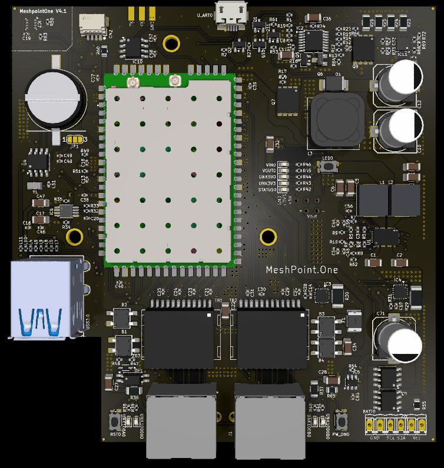

# MeshPoint
MeshPoint is Open source Wifi Hotspot for Crisis Situations
www.meshpointone.com

## MeshPoint v4.1

## Technical Specifications

- **CPU / SoC:** 700 MHz Quad-core Cortex-A7 / Qualcomm IPQ4018
- **RAM memory and storage:** 128 MB NAND and 8 MB NOR flash, 256 MB DDR3 RAM
- **Wi-Fi standards:** 802.11 a/b/g/n/ac Wave 2
- **Mesh protocol:** 802.11s mesh networking protocol
- **Radio:** 2.4 GHz and 5 GHz dual band
- **MIMO:** 2.4 GHz 2x2 MIMO / 5.8 GHz 2x2 MIMO
- **VLAN:** 802.1Q VLAN
- **Monitoring:** SNMP v2 / SNMP v3
- **Environment:** Indoor / Outdoor
- **Concurrent clients:** 300+
- **PoE mode:** Passive PoE in and PoE out
- **Power supply:** Battery powered, solar powered or PoE in
- **Antennas:** Internal dual-band antennas, 7 dBi
- **Wireless security:** WEP, WPA-PSK, WPA-Enterprise (WPA/WPA2, TKIP/AES), WPA3
- **Power consumption:** Average 4 W, maximum 12 W
- **Maximum TX power:** 20 dBm
- **Operating temperature:** -40 °C to 70 °C (-40 °F to 158 °F)
- **Licence:** Free
- **Available interfaces:** USB 2.0, USB 3.0, I2C, I2S, TDM, SPI, UART, GPIO, JTAG
- **Network ports:** 2x 1000BASE-T Ethernet ports
- **LTE modem option:** USB LTE Cat 4 modem

## New features

- [x] PoE Passtrough ( IN + OUT - daisy-chain )
- [x] On board sensor PRESSURE HUMIDITY TEMP
- [x] PCF8563T - on board RTC

## Licence

This project (hardware designs, 3D files and documentation) is released under the
**CERN Open Hardware Licence Version 2 - Strongly Reciprocal (CERN-OHL-S v2)**.

See the [LICENCE](LICENCE) file for the full text.
More info: https://cern-ohl.web.cern.ch/
